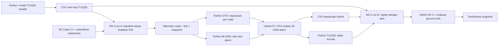
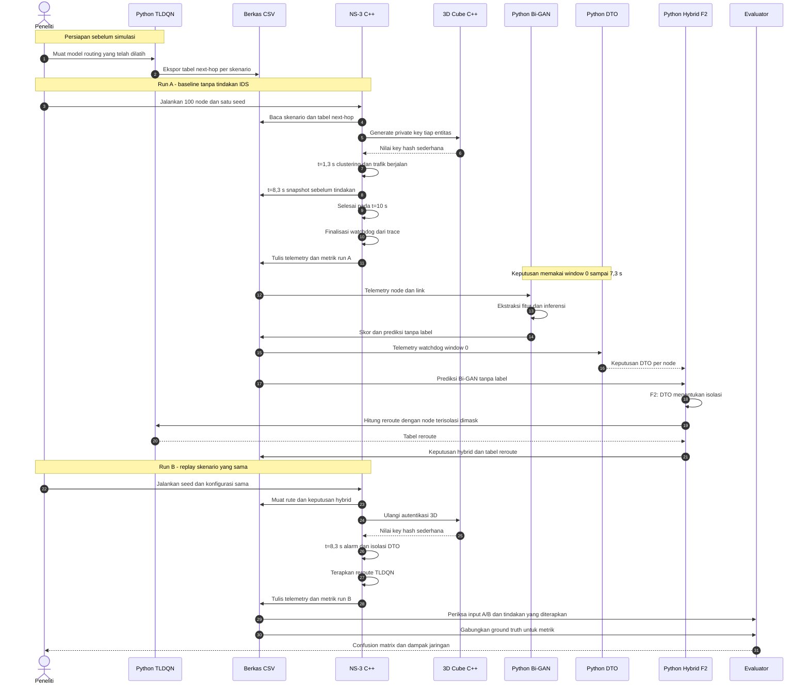

# Teaching and Visualization Brief: HieMulti-Block

## Cara menggunakan dokumen ini

Dokumen ini adalah ringkasan mandiri untuk diberikan kepada ChatGPT atau alat
visualisasi lain. Tujuannya adalah membuat teaching notes, diagram arsitektur,
sequence diagram, dan grafik performa berdasarkan eksperimen proyek ini.

**Aturan penting:** bedakan isi paper, keputusan rekonstruksi, dan hasil simulasi
proyek. Jangan membuat angka, koneksi live, tindakan isolasi, atau fitur yang
tidak dinyatakan di bawah. Bila data tidak tersedia, tulis `N/A`.

## 1. Identitas penelitian

- Paper: J. Kipongo, T. G. Swart, dan E. Esenogho, *Artificial Intelligence-Based
  Intrusion Detection and Prevention in Edge-Assisted SDWSN With Modified
  Honeycomb Structure*, IEEE Access, 2024.
- DOI: https://doi.org/10.1109/ACCESS.2023.3347778
- Tujuan paper: menggabungkan autentikasi, topologi honeycomb, routing cerdas,
  hybrid intrusion detection, prevention, dan blockchain hierarkis pada SDWSN.
- Tujuan proyek: merekonstruksi bagian-bagian tersebut di NS-3 dan Python,
  mengukur hasil yang benar-benar diperoleh, dan menjelaskan deviasinya.
- Nama pendek yang benar: **TLDQN**, bukan TLQDN; **Bi-GAN**; **DTO**;
  **3D Cube**; dan **HieMulti-Block**.

## 2. Teaching notes: konsep dan istilah

### Jaringan dan ancaman

- **WSN** adalah jaringan node sensor yang berkomunikasi dan memiliki sumber
  daya terbatas. **SDWSN** memisahkan fungsi kontrol dari data plane jaringan.
- Topologi yang digunakan memiliki 100 sensor dan 4 edge sink. Koordinat sensor
  berasal dari kode yang dirilis penulis. Label cluster/cell pada gambar konseptual
  paper tidak otomatis berarti cluster head mengendalikan routing pada proyek ini.
- Dalam skenario uji, 10 dari 100 sensor ditetapkan malicious oleh generator
  skenario. **Ground truth** adalah label acuan untuk mengatur perilaku simulasi
  dan mengevaluasi hasil; bukan prediksi DTO atau Bi-GAN.
- Penyerang pada simulasi proyek melakukan **flooding** (laju kirim lebih tinggi)
  dan **grayhole** (relay malicious menjatuhkan paket transit dengan peluang 0,7).
  Kombinasi perilaku ini adalah asumsi simulasi proyek, bukan klaim detail yang
  pasti ditentukan paper.

### Empat modul

| Modul | Peran | Implementasi proyek dan batas |
|---|---|---|
| 3D Cube | Autentikasi / private key | Berjalan dalam C++ NS-3. Rekonstruksi XOR/FNV sederhana; bukan DNN/MCTS atau SHA-256 penuh seperti penjelasan paper. Tidak ada model 3D Python yang dipanggil. |
| TLDQN | Routing cerdas | Model DQN dengan transfer learning dilatih di lingkungan Python proksi; Python mengekspor tabel next-hop yang kemudian dipasang sebagai host route di NS-3. |
| Bi-GAN | Alarm intrusi | G/E/D di Python memproses 32 fitur agregat telemetry NS-3 per sensor dan window, kemudian mengeluarkan skor dan prediksi. Belum identik dengan fitur flow/packet dan klasifikasi per paket pada paper. |
| DTO | Identifikasi node malicious | Optimizer Python memakai bukti watchdog dari telemetry. Keluaran dapat berupa `normal`, `malicious`, atau `insufficient_evidence`. Bukti energi belum tersedia secara andal pada metode ini. |

### Keputusan F2 dan pencegahan

- **F2** adalah aturan proyek untuk pilot hybrid: keputusan DTO `malicious`
  mengisolasi sensor; Bi-GAN menghasilkan alarm, tetapi tidak mengisolasi node
  dengan sendirinya.
- `insufficient_evidence` berarti observasi DTO tidak cukup, bukan bukti node
  normal. Tidak ada isolasi DTO hanya karena status ini.
- Routing setelah isolasi diperbarui memakai tabel reroute TLDQN yang dihitung
  dengan kandidat terisolasi dimask. Tidak boleh memakai ground truth untuk
  memutuskan node mana yang diisolasi atau jalur mana yang dipilih.
- Tabel rute juga menyimpan kolom label untuk **pemeriksaan konsistensi skenario**
  NS-3. Kolom tersebut bukan input pemilihan aksi routing pada konfigurasi pilot.
- Mekanisme blockchain proyek adalah hash dan pembagian sederhana; jangan
  gambarkan sebagai blockchain dengan konsensus yang sudah tervalidasi.

## 3. Arsitektur sistem aktual

**Interpretasi:** alur memakai file dan dua run deterministik, bukan komunikasi
live Python-NS-3. Dashboard menampilkan snapshot hasil, bukan simulasi live.
Belum ada integrasi ns3-gym pada eksperimen ini.

## 4. Sequence diagram Python dan NS-3

**Kausalitas:** keputusan Python memakai telemetry window `[0, 7,3 s)`.
Dengan `wdLate=1 s`, observasi window itu tersedia paling lambat pada 8,3 s.
Klasifikasi watchdog implementasi saat ini difinalisasi setelah run A, lalu
dipakai pada replay; jangan visualisasikan seolah inference berjalan live di
dalam run A. Run A dan B memakai seed dan konfigurasi yang sama.

## 5. Data, training, dan pemisahan eksperimen

| Tahap | Data / seed | Kegunaan |
|---|---|---|
| Training Bi-GAN | NS-3 benign seed 101, 102, 103 | Melatih model dari 300 contoh sensor tanpa label serangan. |
| Kalibrasi awal | NS-3 benign seed 104 | Kalibrasi threshold awal berbasis benign. |
| Validasi threshold akhir | Skenario serangan seed 1, 2, 3 | Memilih threshold dengan **label validasi**. |
| Uji akhir | Skenario serangan seed 4, 5, 6 | Evaluasi threshold yang sudah dibekukan dan replay F2. |

- Threshold akhir: `0.4741064757`; prediksi intrusi jika `score > threshold`.
- Aturan pemilihan: maksimalkan F1 gabungan pada validasi dengan FPR gabungan
  maksimal 5%. Angka 5% adalah target pilot, **bukan standar universal**.
- Karena label serangan validasi dipakai memilih threshold, jangan sebut seluruh
  pipeline sebagai tanpa supervisi. Label seed uji tidak dipakai memilih threshold.
- Tiap run pilot berdurasi 10 detik dan menggunakan window 7,3 detik; 100 sensor
  per seed. `run A` dan `run B` adalah run berbeda dengan seed sama.
- Bi-GAN pilot tidak memakai checkpoint feature-selection NSL-KDD Phase 1. NSL-KDD
  digunakan dalam eksperimen terdahulu dan hybrid historis, bukan input Bi-GAN
  telemetry terbaru.

## 6. Metrik dan definisi

- `TP`: malicious diprediksi malicious; `TN`: normal diprediksi normal.
- `FP`: normal salah diprediksi malicious; `FN`: malicious terlewat.
- `Precision = TP / (TP + FP)`.
- `Recall = TP / (TP + FN)`.
- `F1 = 2 * Precision * Recall / (Precision + Recall)`.
- `FPR = FP / (FP + TN)`.
- `PDR` = paket diterima / paket dikirim. **Benign PDR** hanya menghitung aliran
  dari sensor dengan ground truth normal; label ini digunakan untuk evaluasi.
- **Poin persentase (pp)** adalah selisih langsung dua persentase; jangan menulis
  kenaikan 2,12 pp sebagai kenaikan relatif 2,12%.
- Lifetime di metrik proyek adalah **proyeksi**, bukan first-node-death terukur.
  Control overhead adalah hitungan pesan kontrol logis, bukan seluruh paket aktual.

## 7. Hasil uji akhir: 100 node, seed 4-6

Angka berikut adalah hasil proyek, **bukan angka yang diklaim paper**. Confusion
matrix dipool pada tiga seed: 300 keputusan sensor, 30 malicious, 270 normal.

| Sumber keputusan | TP | FP | FN | TN | Precision | Recall | F1 | FPR |
|---|---:|---:|---:|---:|---:|---:|---:|---:|
| Bi-GAN telemetry | 27 | 7 | 3 | 263 | 79,4% | 90,0% | 84,4% | 2,59% |
| DTO | 12 | 2 | 18 | 268 | 85,7% | 40,0% | 54,5% | 0,74% |
| Isolasi F2 | 12 | 2 | 18 | 268 | 85,7% | 40,0% | 54,5% | 0,74% |

F2 mengisolasi 14 node: 12 malicious dan 2 normal. Bi-GAN menghasilkan 34 alarm
(27 benar, 7 salah); alarm Bi-GAN saja tidak memicu isolasi pada F2. DTO memiliki
176 keputusan `insufficient_evidence` dari 300 keputusan sensor lintas run.

| Seed | Bi-GAN F1 | Bi-GAN FPR | Alarm Bi-GAN | Isolasi DTO | Rute berubah |
|---:|---:|---:|---:|---:|---:|
| 4 | 76,2% | 3,33% | 11 | 4 | 7 |
| 5 | 81,8% | 3,33% | 12 | 4 | 6 |
| 6 | 95,2% | 1,11% | 11 | 6 | 9 |

### Perbandingan jaringan berpasangan

Run A = baseline tanpa tindakan IDS. Run B = hybrid F2. Pasangan memakai seed,
jumlah node, skenario, rute awal, dan konfigurasi simulasi yang sama.

| Seed | Benign PDR A | Benign PDR B | Paket jujur dikirim A -> B | Paket jujur diterima A -> B | Grayhole drops A -> B |
|---:|---:|---:|---:|---:|---:|
| 4 | 85,8031% | 88,1287% | 3.698 -> 3.698 | 3.173 -> 3.259 | 602 -> 496 |
| 5 | 96,6748% | 97,2951% | 3.669 -> 3.660 | 3.547 -> 3.561 | 191 -> 154 |
| 6 | 82,3928% | 85,8075% | 3.686 -> 3.678 | 3.037 -> 3.156 | 734 -> 589 |

- Rata-rata selisih benign PDR per pasangan: **+2,12 pp**, bukan pooled PDR.
- Total paket jujur diterima: **+219**; total paket jujur dikirim: **-17**.
- Snapshot pra-aksi dan input DTO identik pada **3/3** pasangan. Fitur Bi-GAN
  juga identik; alarm, jumlah isolasi dan reroute di NS-3 cocok dengan keputusan.
- `isolation_transit_drops=0` dan `reroute_unresolved=0` pada tiga run ini.
  Jangan menyimpulkan bahwa isolasi tidak berpengaruh hanya dari angka tersebut;
  rute dapat dialihkan sebelum trafik mencapai node yang diisolasi.

## 8. Perbedaan penting dengan paper

| Topik | Paper / rancangan | Kondisi eksperimen proyek |
|---|---|---|
| Simulator | NS-3.26 | NS-3.48; modul kustom penulis tidak tersedia lengkap. |
| Durasi | 600 s | Pilot hybrid ini 10 s. Event delegator pada 15,3 s tidak dijalankan. |
| Beban | 1000 paket/node | 50 paket/node pada konfigurasi proyek karena batas memori. |
| Bi-GAN | Flow dan packet; klasifikasi paket | 32 fitur agregat telemetry per sensor/window. |
| 3D dan blockchain | 3D Cube dengan DNN/MCTS, blockchain hierarkis | Disederhanakan; jangan klaim implementasi penuh. |
| Integrasi | Arsitektur paper menggambarkan fungsi sistem | Proyek menggunakan Python + CSV + dua run NS-3; belum live/ns3-gym. |
| Validasi | Paper melaporkan hasilnya sendiri | Proyek ini hanya tiga seed uji 100 node dan satu model; tidak cukup untuk klaim deployment. |

**Jangan membandingkan angka secara langsung** tanpa menjelaskan perbedaan data,
satuan klasifikasi, durasi, beban, fitur, dan metodologi. Jangan menggunakan
hasil NSL-KDD historis atau run hybrid lama seolah-olah berasal dari Bi-GAN
telemetry baru.

## 9. Prompt siap pakai untuk ChatGPT

Berikan dokumen ini kepada ChatGPT bersama prompt berikut:

> Bertindak sebagai dosen dan visual designer riset jaringan. Gunakan hanya
> fakta dan angka dalam dokumen ini. Buat materi pengajaran berbahasa Indonesia
> untuk mahasiswa yang baru mengenal proyek: (1) teaching notes tentang masalah,
> istilah, dan peran empat modul; (2) diagram arsitektur yang membedakan Python,
> NS-3, CSV, dan dashboard; (3) sequence diagram run A dan run B; (4) visualisasi
> confusion matrix dan grafik perbandingan benign PDR serta paket jujur per seed;
> (5) ringkasan keterbatasan dan lima pertanyaan diskusi beserta jawabannya.
> Gunakan kode Mermaid yang dapat diedit untuk diagram. Beri judul, satuan,
> label seed, dan sumber angka pada setiap grafik. Jelaskan bahwa threshold
> dipilih menggunakan label validasi, bahwa hasil adalah tiga run simulasi 10 s,
> dan bahwa Bi-GAN pada F2 hanya memberi alarm. Jangan mengarang API live,
> konsensus blockchain, hasil NSL-KDD untuk pilot, atau metrik yang tidak tersedia.
> Pisahkan secara jelas pernyataan paper dari asumsi dan hasil proyek.

## 10. Sumber dan penelusuran

- [Desain dan hasil pilot Bi-GAN NS-3](BIGAN_NS3_PILOT.md)
- [Laporan evaluasi hybrid F2](../ml/reports/bigan_ns3_pilot/pilot_20261107_211217/hybrid_f2_4_6/evaluation.json)
- [Gerbang determinisme](../ml/reports/bigan_ns3_pilot/pilot_20261107_211217/hybrid_f2_4_6/determinism.json)
- [Gerbang penerapan keputusan](../ml/reports/bigan_ns3_pilot/pilot_20261107_211217/hybrid_f2_4_6/applied.json)
- [Pemilihan threshold](../ml/reports/bigan_ns3_pilot/pilot_20261107_211217/threshold_selection.json)
- [Deviasi paper dan implementasi](PAPER_DEVIATIONS.md)
- [Implementasi NS-3](../ns3-sim/honeycomb-sdwsn.cc)
- [Eksportir keputusan hybrid](../ml/hybrid_ids.py)
- [Dashboard](../dashboard/index.html)