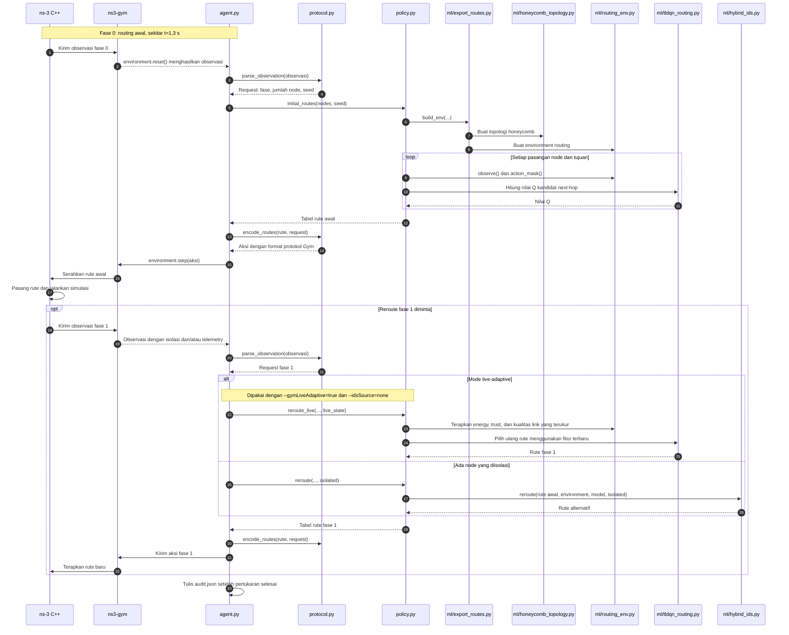

# Teaching Notes: TLDQN melalui ns3-gym

## Tujuan pembelajaran

Setelah sesi ini, peserta diharapkan dapat:

1. Menjelaskan pembagian tugas antara simulator ns-3 dan policy TLDQN di Python.
2. Mengikuti alur observasi dan aksi dari fase 0 hingga reroute fase 1.
3. Membedakan reroute karena isolasi node dari reroute berbasis telemetry live.
4. Menjelaskan batas eksperimen tanpa menganggapnya sebagai training ulang atau implementasi siap-deploy.

## Gambaran inti

ns-3 menjalankan jaringan dan mengirim kondisi routing kepada Python melalui ns3-gym. Python menjalankan checkpoint TLDQN yang dibekukan, memilih next-hop, lalu mengirim tabel rute kembali ke simulator. Simulasi tetap berjalan di ns-3; Python tidak menjalankan satu langkah Gym untuk setiap paket.

Pada waktu simulasi 1,3 detik, sebelum aliran sensor dimulai, agent menerima permintaan routing awal secara batch. Pada mode live-adaptive, simulator mengirim satu permintaan routing tambahan pada 8,3 detik. Itu adalah checkpoint kedua, bukan episode training atau keputusan per paket.

## Sequence diagram runtime

### Cara membaca fase

- **Fase 0** adalah permintaan routing bootstrap. Belum ada telemetry trafik dari simulasi, sehingga rute awal menggunakan environment proxy baseline Python.
- **Fase 1** adalah permintaan routing tambahan jika mode run mengharapkannya. Dalam mode live-adaptive, telemetry NS-3 dipakai untuk menghitung ulang rute. Dalam mode dengan isolasi, daftar node terisolasi dipakai untuk menghindari node tersebut.
- Nomor fase menandai urutan permintaan routing Gym. Nomor itu bukan nomor episode reinforcement learning.
- Agent mencatat keputusan dan durasi inferensi ke audit; waktu inferensi Python dilaporkan terpisah dari waktu simulasi.

## Peran file Python

### Runtime dan policy

| File | Peran saat mengajar |
|---|---|
| `ns3-sim/tldqn_gym/agent.py` | Klien ns3-gym. Memeriksa urutan fase, memilih fungsi policy, mengirim aksi, mencetak keputusan, dan menulis `audit.json`. |
| `ns3-sim/tldqn_gym/protocol.py` | Membaca dan memvalidasi observasi serta mengemas tabel rute menjadi aksi. Mencegah pesan dengan ukuran, nilai, atau entri rute yang tidak valid. |
| `ns3-sim/tldqn_gym/policy.py` | Memuat checkpoint beku, membangun environment routing, menghitung rute awal, reroute setelah isolasi, atau menghitung rute dengan telemetry live. |
| `ml/export_routes.py` | Menyediakan `build_env` dan lokasi model baseline yang dipakai policy. Pada jalur Gym, agent tidak membaca tabel rute CSV saat runtime. |
| `ml/honeycomb_topology.py` | Menggambarkan topologi dan kandidat next-hop untuk routing. |
| `ml/routing_env.py` | Menentukan state, fitur, dan action mask yang menjadi masukan policy. |
| `ml/tldqn_routing.py` | Menyediakan Q-network dan pemilihan aksi next-hop dengan kandidat yang valid. File ini juga berisi kode training, tetapi eksekusi Gym memakai inferensi checkpoint, bukan training. |
| `ml/hybrid_ids.py` | Menyediakan fungsi reroute yang menghindari node terisolasi. Jalur ini berbeda dari perhitungan live-adaptive TLDQN-only. |

### Analisis hasil dan pengujian

| File | Peran |
|---|---|
| `ns3-sim/tldqn_gym/check_parity.py` | Membandingkan audit dan rute Gym dengan baseline, serta memeriksa input telemetry dan aksi reroute. Memakai utilitas pembanding dari `ml/hybrid_eval.py`. |
| `ml/build_dashboard.py` | Mengumpulkan hasil run ketiga mode dan menghasilkan `dashboard/index.html`. Ini proses pasca-simulasi. |
| `ns3-sim/tldqn_gym/test_agent.py` | Menguji urutan pertukaran fase dan perilaku agent pada reroute biasa maupun live-adaptive. |
| `ns3-sim/tldqn_gym/test_protocol.py` | Menguji parsing observasi dan validasi aksi protokol. |
| `ns3-sim/tldqn_gym/test_policy.py` | Menguji determinisme, parity rute baseline, validasi isolasi, dan pemakaian fitur live. |
| `ns3-sim/tldqn_gym/test_parity.py` | Menguji gerbang perbandingan hasil, termasuk syarat reroute live diterapkan. |
| `ns3-sim/tldqn_gym/test_dashboard.py` | Memastikan dashboard menandai run yang belum tersedia, bukan mengarang metrik. |
| `ns3-sim/tldqn_gym/test_cpp_contract.py` | Menguji kontrak penerima rute di C++ dan melakukan pemeriksaan sintaks lokal dengan stub. Bukan bukti bahwa seluruh integrasi upstream ns3-gym berjalan di semua server. |

## Batas interpretasi

- Checkpoint TLDQN dibekukan dan hash-nya diperiksa; run ini tidak melatih ulang model.
- Rute awal memakai proxy baseline karena telemetry trafik belum tersedia. Dalam mode live-adaptive, fitur link yang belum terukur memakai fallback proxy.
- Mode live-adaptive hanya menjalankan aksi TLDQN. README mensyaratkan `--idsSource=none`; tindakan DTO/Bi-GAN tidak diterapkan dalam jalur itu.
- Label skenario tidak dikirim sebagai observasi kepada agent. Label lokal simulator dipakai untuk mengatur penyerang dan evaluasi.
- Reward Gym saat ini adalah placeholder nol, bukan ukuran objektif routing yang sudah dievaluasi.
- Baseline rekaman yang disebut README mencakup 100 node dan seed 4, 5, dan 6. Jangan menggeneralisasi hasil di luar cakupan tersebut.
- Pemeriksaan lokal tidak menggantikan validasi build dan runtime upstream ns3-gym pada environment ns-3.48 yang terisolasi. Jalur live-adaptive masih memerlukan validasi run server sesuai README eksperimen.
- README memperingatkan bridge upstream dapat bind ke semua interface. Eksperimen harus dijalankan di environment terisolasi dengan pembatasan jaringan yang sesuai.

## Pertanyaan diskusi

1. Mengapa policy memakai proxy untuk routing awal, tetapi dapat memakai telemetry live pada fase berikutnya?
2. Apa perbedaan data yang diterima `reroute()` dan `reroute_live()`?
3. Mengapa checkpoint fase 1 lebih hemat daripada meminta keputusan routing untuk setiap paket?
4. Apa yang dapat dibuktikan oleh parity checker, dan apa yang tetap perlu dibuktikan lewat runtime simulator?
5. Mengapa hasil dari tiga seed baseline belum cukup untuk menyebut sistem siap-deploy?

## Referensi implementasi

- [README eksperimen TLDQN Gym](../ns3-sim/tldqn_gym/README.md)
- [Agent](../ns3-sim/tldqn_gym/agent.py)
- [Policy](../ns3-sim/tldqn_gym/policy.py)
- [Protokol](../ns3-sim/tldqn_gym/protocol.py)
- [Simulator C++](../ns3-sim/honeycomb-sdwsn.cc) (`--routeSource=gym`)
